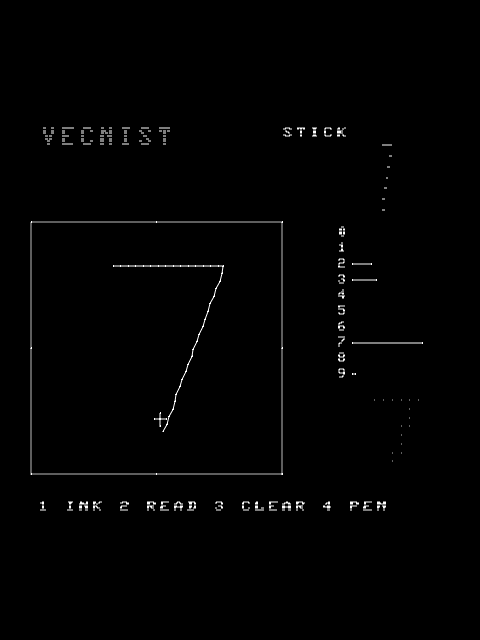

# VecNIST: a Vectrex that reads your handwriting

Draw a digit on a **Vectrex** (a 1982 vector console: a 6809 at 1.5 MHz, 1 KB of RAM, a vector CRT) and it tells
you which digit it is. It uses a small neural network trained on MNIST on a PC and built into the cartridge as
integers.



## Play it
**Web page, ROM and demo:** <https://magneato.github.io/vecinst/>. The ROM is [`rom/vecnist.bin`](rom/vecnist.bin) and the
demo is [`vecinst.mp4`](vecinst.mp4).
```
./setup.sh      # once: lwasm, MAME, Python + numpy + Pillow, ffmpeg; checks for the Vectrex BIOS
./build.sh      # build/vecnist.bin (and rom/vecnist.bin); checked against Vide's own assembler if Vide is there
./run.sh        # play it in MAME   (--pen: MAME's light pen on the mouse; --video FILE.mp4: record the demo)
```
No Vectrex? `mame vectrex -cart rom/vecnist.bin` (MAME needs the Vectrex BIOS, `vectrex.zip`). On a real Vectrex,
put `rom/vecnist.bin` on a flash cartridge; it hasn't been tried on real hardware yet. The BIOS shows its own screen
for about 10 seconds, then the title, then the game.

| Control | |
|---|---|
| **joystick** | move the cursor |
| **button 1** | ink (hold it to draw) |
| **button 2** | read the drawing now (it is also read every time a stroke ends) |
| **button 3** | clear |
| **button 4** | joystick / light pen |

The answer appears top right. There's a bar for each digit (the longest is the answer) and, below them, the 12×12
grid the network actually saw.

### In Vide
This folder is a [Vide](http://vide.malban.de/) project (`VecNISTProjectProperty.xml`, main file `vecnist.asm`).
Link it into Vide's `projects` folder, e.g. `ln -s ~/4004/vectrex ~/4004/Vide.u32/projects/VecNIST`, then open
*VecNIST* in Vide and assemble and run it as usual. `./build.sh` assembles it with lwasm and with Vide's own
assembler (`de.malban.vide.assy.Asmj`, called from `tools/VideAsm.java`), and both must produce the same bytes.

### Training
```
./get_mnist.sh                       # MNIST into data/ (copied from ../coco3/nsx6809/data if it is there)
python3 train/vecnist.py train       # about 40 seconds; writes weights.i and build/model.npz
```
Only numpy is needed. The trained `weights.i` is committed, so the cartridge builds without MNIST.

## How it works
**Making MNIST look like a Vectrex drawing.** A joystick draws thin strokes, but MNIST digits are thick, blurry
scans. So on the PC each MNIST digit is thresholded and thinned to a one-pixel skeleton (Zhang–Suen). Then the
skeleton goes through the very same integer steps the Vectrex applies to a drawing:
1. take the bounding box;
2. fit its longer side to 9 cells with one `MUL` by a reciprocal table (`RECIP[size] = 2048 // size`), with no
   division;
3. centre it in a 12×12 grid.

Strokes are joined by an 8-connected walk. Training adds small random rotations, slants and stretches, the way a
joystick drawing wobbles.

**The network** is 144 inputs → 64 hidden → 10, with 8-bit weights (10 KB of the 12 KB cartridge).
* **Layer 1 is additions only.** Each input is a grid cell, 0 or 1, so each inked cell just adds its row of 64
  weights into 16-bit sums. There are no multiplications.
* **Activations:** each sum becomes `clamp(sum >> K1, 0, 255)`.
* **Layer 2 is `MUL`.** It multiplies each activation by |weight| and adds or subtracts it into a 24-bit score.
  The highest of the ten scores is the answer.
* **Speed:** one reading is roughly 65–80K cycles, about 50 ms (estimated from the instruction counts, not
  measured).

**Measured:**
* **Accuracy:** 93.2% on the 10,000 MNIST test digits, as thinned 12×12 grids (`python3 train/vecnist.py test`).
  The integer network is within 0.1% of the float one (93.1%).
* **Matches the twin:** the cartridge's answers and all ten scores match the Python twin **byte for byte** on 400
  drawings in MAME. For 100 of them the cartridge also rasterised the strokes itself, and the grids match too
  (`test/twin_test.py`).
* **Hand-drawn digits:** a 1, a 7 and a 0 drawn with the scripted joystick are read correctly
  (`screenshots/drawn_*.png`).

## The light pen (optional, unverified)
The light pen's photocell pulses the VIA's CA1 line when the beam lights up under it. VecNIST works the way light
pens always did: it locks on. A 7×7 patch of dots, 2 units apart, is the pen's cursor. Touch the pen to it and the
patch follows the pen, re-centring each frame on the dots that saw it. Button 1 inks.
* **In MAME:** pen mode runs (`LPENCONF` = 1, "port 1"), and the patch moves when MAME reports the pen. But
  MAME's pen emulation turned out to report all of a patch's dots or none of them, so following a stroke there is
  erratic.
* **On a real Vectrex:** not tested.

So treat the pen as experimental. The joystick is the tested way to draw.

The checks behind the numbers are in `test/` (`test/run_tests.sh`, about 15 seconds in MAME).

## Files
```
vecnist.asm        the cartridge: header, input, stroke list, rasteriser, network, display, light pen
setup.sh build.sh run.sh   install, build, play / record
bios.i, ram.i      BIOS addresses used; where everything lives in the 1 KB
weights.i          the trained network and the reciprocal table (generated)
train/vecnist.py   MNIST, thinning, the Vectrex's arithmetic twinned, training, quantisation
tools/             VideAsm.java (Vide's assembler without the IDE), art.py (overlay, screens, social card)
overlay/           the Vectrex overlay (Vide / ParaJVE take it as it is)
index.html art/    the web page (GitHub Pages) and its pictures
rom/vecnist.bin    the published ROM
test/              harness.lua (MAME: scripted stick, buttons, light pen, pokes), mv.sh, twin_test.py, shot.py
```

## Credits
MNIST: Yann LeCun, Corinna Cortes and Christopher J.C. Burges (not included; `get_mnist.sh` fetches it). The
Vectrex BIOS addresses follow the BIOS listing and Vide's `VECTREX.I`. Vide is Malban's. MAME's Vectrex driver
was used for testing.

## Licence
BSD 3-Clause, (c) 2026 Robert Sitton: see [LICENSE](LICENSE). MNIST, the Vectrex BIOS and MAME belong to their owners.
